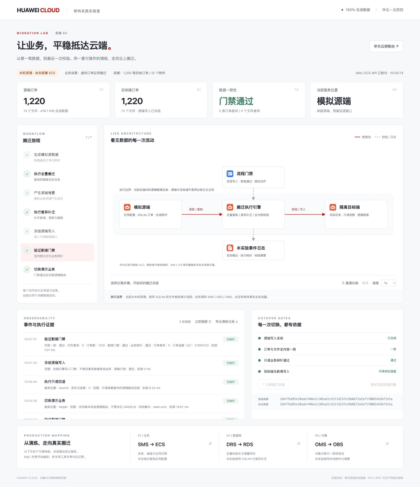

# 华为云搬迁实践实验室

100% 合成数据的可操作演练：生成源数据 → 全量复制 → 生成增量 → 差异补迁 → 冻结写入 → 全内容校验 → 逻辑割接 → 只读窗口回退。

当前交付为**本机预演**。2026-11-13 已成功访问华为云北京四控制台，并通过既有凭证完成 IAM 项目与 ECS 列表的只读查询；该区域没有可复用 ECS。本次没有创建付费资源，没有执行 SMS、DRS、OMS 任务，没有修改真实 DNS/ELB。真实 ECS 的执行方式及费用待用户选择。不能将本机演练报告用作真实云服务迁移的验收证明。



复用已有华为云最佳实践 Demo 的声明式清单、官方 SVG 图标与动作/事件布局；图标直接内联，防止 WebView 中 SVG 图片引用失效。架构图遵循红白配色、正交连线及管理面/数据面分离规范。`manifest.json` 是从固定引擎动作及架构模型导出的演练清单；执行逻辑在 `engine.py`，并非通用 GUI 可直接加载的 SSH manifest。

## 启动

Python 3.9+，普通运行仅依赖 Flask：

```sh
python3 -m venv .venv
.venv/bin/pip install -r requirements.txt
.venv/bin/python app.py --port 8901
```

打开 `http://127.0.0.1:8901/`。按左侧七个步骤演练，右侧观察门禁与事件。割接后可点“只读窗口回退”；如点“测试写后回退拦截”，引擎会在目标插入一笔虚构订单，之后回退请求会被后端明确拦截。

前端支持按业务方向逐段流动、到达节点响应、0.5×/1×/2× 调速、暂停/继续、纯视觉重播、五秒无缓存状态刷新、JSON 记录导出和窄屏布局。重播不会请求执行接口。

运行时默认位于 `~/.local/state/cloud-migration-lab`，也可用 `MIGRATION_RUNTIME` 指定新的空目录开始另一轮。保留旧目录即可保留证据；没有自动删除功能。不要同时使用 CLI 与 GUI 修改同一运行时。

## 合成数据及验证

- 初始：1,200 笔虚构订单、12 个文本附件和 1 个应用配置；不含真实身份、客户或业务数据。
- 增量：新增 25 笔、更新 10 笔、删除 5 笔，净订单数为 1,220；附件新增/修改/删除各 1 个。
- 全量：SQLite backup API 复制数据库，文件复制保留源端。
- 差异补迁：订单按主键比对全部列并 upsert/delete，文件按 SHA-256 比对；这是教学用差异补迁，**不是数据库日志 CDC**。
- 校验：对全部排序订单和文件摘要计算统一 SHA-256；逐项比较内容、删除与新增；目标执行只读 COUNT/SUM 业务探针。
- 割接：源端必须冻结、最新校验通过且当前内容仍一致；仅切换实验引擎逻辑路由，不修改外部业务入口。
- 回退：仅允许目标未产生新写入且两端仍一致的只读窗口回切。写后回退需要另行设计反向同步/合并，本实验会拦截，不做丢弃目标写入的演示。

## 可选：既有 ECS 运行引擎

云资源创建与费用确认完成后，可复用同一引擎经 SSH 在指定测试 ECS 上运行。执行器通过 stdin 向远端 Python 发送固定引擎代码，远端使用专属路径 `.local/state/cloud-migration-lab`。

在仓库之外的 `~/.ssh/config` 配置 `migration-lab-ecs`，使用专门测试账号、私钥与已经验证的 `known_hosts`。安全组只放行操作者出口 `/32` 的 SSH，不开放演示 Web 端口。先人工核验主机指纹，再启动：

```sh
MIGRATION_SSH_HOST=migration-lab-ecs .venv/bin/python app.py --port 8901
```

SSH 使用 `BatchMode=yes` 与 `StrictHostKeyChecking=yes`，连接或指纹异常不会降级。前端与控制后端仍在本机，云端只运行合成数据引擎；源/目标依然是单 ECS 内不同目录，不能代表跨主机迁移的吞吐、时延、网络容灾或 SMS/DRS/OMS 能力。此 SSH 路径尚未在真实 ECS 上验收。

只读账号检查使用 `cloud_check.py`；先安装 `requirements-cloud.txt`，通过 `HWC_CREDENTIALS_CSV` 读取既有凭证文件。CSV 列为 `Access Key Id` / `Secret Access Key`，恰好一行。AK/SK 仅驻留进程内存，不写入仓库、前端或证据。检查结果写入私有运行时的 `cloud-check.json`；页面显示“已核对”及时间，而非实时连接承诺。

## 架构约束与取舍

| 维度 | 本演练 | 生产迁移需验证 |
| --- | --- | --- |
| 业务与规模 | 虚构订单应用，单次补迁、单操作者，数据小于 1 MiB | 真实应用依赖、变更率、峰值 TPS、数据体量与停机窗 |
| 数据与合规 | 纯合成数据，无个人信息；区域假设北京四 | 数据驻留、跨境、加密、审计保留和许可证要求 |
| 安全与 IAM | 本机绑定，校验 Host/Origin/随机令牌，固定动作，运行时目录 0700；既有凭证只读查询 | 最小权限迁移账号、时限授权、凭证轮换；存储加密及审计 |
| 网络 | 本机回环；可选 SSH 固定主机指纹、只放行操作者 `/32` | 地址不重叠、路由/DNS、专线/VPN/公网吞吐；分别验证控制与数据通道 |
| 可靠性 | SQLite 事务、原子状态文件、操作互斥、保留源端 | 多 AZ 的应用与托管数据库、重试、断点续传、兼容性及业务验收 |
| 性能 | 展示实测动作毫秒数与实际记录/文件差异 | 峰值压测、迁移限速、端到端带宽与源端负载；小样本不可外推 |
| 可观测性 | 实际动作事件、错误/拦截、校验摘要、JSON 导出 | CES/LTS/CTS，错误率与延迟门槛、复制积压和告警 |
| 灾备 / RTO / RPO | 割接条件为零内容差异；只读窗回退，不承诺生产 RTO/RPO | 业务假设 RTO≤30 分钟、割接 RPO=0，需停写/最后同步与恢复实测；目标写后回退单独设计 |
| 成本 | 当前未创建付费资源；仅本机运行 | 最小实验建议 1 台 x86 小规格 ECS、40 GB 系统盘；按需，EIP 按需选择，控制台实时报价后确认预算；结束后释放资源，关机不等于释放 |

未引入多云、多区域、Kubernetes、队列或自建数据库集群。生产目标优先托管服务，但本实验使用 SQLite 把数据一致性过程做成可重复观察的最小练习。

## 生产方案映射

- MgC：资源发现、评估与迁移旅程编排，不是所有数据统一经过的传输节点。[官方迁移工具说明](https://support.huaweicloud.com/intl/zh-cn/usermanual-caf/caf_01_0154.html)
- SMS → ECS：核对 OS/磁盘/驱动，执行全量、增量与隔离启动验证。[SMS 最佳实践](https://support.huaweicloud.com/intl/zh-cn/bestpractice-sms/sms_12_0001.html)
- DRS → RDS：核对源目标版本、拓扑和对象支持，验证增量延迟与关键业务交易。[DRS 流程](https://support.huaweicloud.com/intl/en-us/qs-drs/drs_qs_0001.html)
- OMS → OBS：核对存储类型、对象数、元数据、归档及增量策略，OBS 不画进 VPC 子网。[MgC 存储迁移实践](https://support.huaweicloud.com/intl/zh-cn/bestpractice-oms/oms_05_5710.html)

## 检查

```sh
.venv/bin/python -m unittest -v test_lab.py
python3 diagram.py
python3 ../../skills/architecture-diagram-tool/scripts/validate_geometry.py geometry.json
node --check static/app.js
```

四项测试覆盖新增/更新/删除、一致性损坏、过期门禁、写后回退拦截、重复生成保护以及 HTTP Host/Origin/令牌/动作白名单。浏览器已实测七步操作、1,200→1,220 笔差异补迁、暂停/重播不产生新后端事件、只读回退及桌面/窄屏布局。真实 ECS 执行与托管迁移服务集成未验证。
