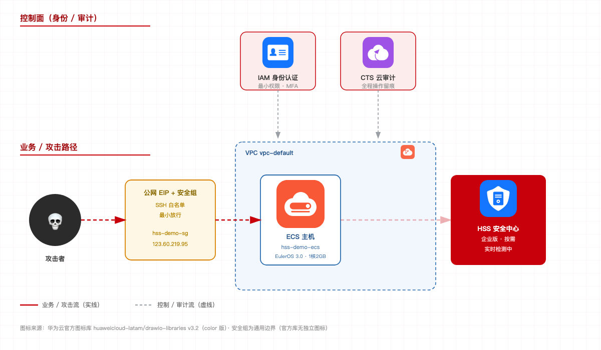

# huawei-cloud-hss-security-demo

> 一键搭建华为云 **HSS 主机安全演示环境**，并生成可对客户展示的**动态攻击链 Demo GUI**（白底红主色 + 华为云官方产品图标）。



[English](#english) · [中文](#中文说明)

---

## 中文说明

### 这是什么

一套「开箱即用」的华为云 HSS 安全 Demo 流水线：

1. **建环境**：安全组 + 按需 ECS（EulerOS 3.0）+ 1Mbps EIP；
2. **装 Agent**：自动取官方安装命令并通过 SSH 安装 HSS Agent；
3. **开防护**：企业版**按需**防护（关掉即停止计费）；
4. **触发 + 检出**：执行危险命令（Webshell / SUID 提权等），实时查询 HSS 安全事件；
5. **动态 GUI**：红白主题页面，展示官方图标架构图 + 攻击链动画 + 实时告警；
6. **架构图**：用华为云官方图标库生成白底红主色 SVG。

### 快速开始

```bash
pip install huaweicloudsdkcore huaweicloudsdkecs huaweicloudsdkvpc huaweicloudsdkeip huaweicloudsdkhss paramiko flask

cp config.example.json config.json   # 填入 ak / sk / project_id / vpc_id / subnet_id
python scripts/01_setup_env.py       # 建安全组+ECS+EIP
python scripts/02_install_agent.py   # 装 HSS Agent
python scripts/03_enable_protect.py  # 开企业版按需防护
python scripts/04_trigger_verify.py  # 触发危险命令并验证检出
python gui/app.py 8899               # 起 GUI -> http://127.0.0.1:8899
python scripts/05_gen_arch.py        # 生成官方图标架构图
```

### 演示效果

- 打开 `http://127.0.0.1:8899`
- 点左侧「Webshell 写入」或「提权（SUID）」
- 架构图上动态跑出「攻击者 → 公网边界 → ECS → HSS → 告警」链路
- 30–90 秒内右侧出现 High 级别安全事件

### 关键坑

见 [SKILL.md](SKILL.md) 的「关键坑与解法」，以及 [references/gotchas.md](references/gotchas.md)。

### 费用

按需约 **8–12 元/天**（ECS + EIP + HSS 企业版）。演示完记得关机/释放。

### 安全

- `config.json`、`demo_password.txt` 已被 `.gitignore` 排除，**请勿提交**。
- 建议使用临时子账号 AK/SK，演示结束即停用。

### 图标来源

华为云官方图标库 [huaweicloud-latam/drawio-libraries](https://github.com/huaweicloud-latam/drawio-libraries) `v3.2`（color 版）。

---

## English

A one-stop pipeline for a **Huawei Cloud HSS (Host Security Service) demo**:

1. Provision security group + on-demand ECS + EIP;
2. Install the HSS agent automatically (official install script via SSH);
3. Enable **on-demand** enterprise protection (billing stops on disable);
4. Trigger dangerous commands and verify real-time detections;
5. Serve a dynamic GUI with the official-icon architecture diagram and attack-chain animation;
6. Generate a Huawei-red/white architecture SVG using official icons.

### Quick start

```bash
pip install huaweicloudsdkcore huaweicloudsdkecs huaweicloudsdkvpc huaweicloudsdkeip huaweicloudsdkhss paramiko flask
cp config.example.json config.json   # fill ak / sk / project_id / vpc_id / subnet_id
python scripts/01_setup_env.py
python scripts/02_install_agent.py
python scripts/03_enable_protect.py
python scripts/04_trigger_verify.py
python gui/app.py 8899
python scripts/05_gen_arch.py
```

See [SKILL.md](SKILL.md) for the full workflow and gotchas.

## License

MIT
